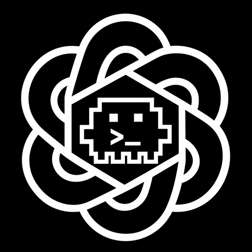

<p align="center">
  
</p>

# Codex ↔ Claude Code

Give Codex a `claude_delegate` MCP tool, give Claude Code a `codex_delegate` tool, or install both. Each call starts a fresh CLI session in the selected workspace and returns the recipient’s final answer to the sending agent.

Every task starts with **AGENT-TO-AGENT DELEGATION**, names the immediate sender and recipient, and tells the recipient that the human may never have seen the sending conversation. The caller supplies a task and optional context. Each reply carries its own attribution, including when a peer delegates back.

## Install

1. Install Node.js 22 or later, Codex CLI, and Claude Code 2.1.248 or later. Sign in to each CLI and confirm it can answer a short prompt. The bridge uses those existing sign-ins. [Codex CLI](https://developers.openai.com/codex/cli/) · [Claude Code setup](https://code.claude.com/docs/en/setup)
2. Clone this repository using its **Code** menu. Keep the checkout where the hosts can continue to launch it.
3. From the checkout, install the locked dependencies.

```sh
npm ci --ignore-scripts
```

### One-way hierarchy

**Codex delegates to Claude Code.** Run this command to install the outbound tool in Codex. The default hop count is one, so Claude returns the result directly.

```sh
node scripts/register.mjs to-claude
```

**Claude Code delegates to Codex.** For the opposite hierarchy, install the outbound tool in Claude Code.

```sh
node scripts/register.mjs to-codex
```

The registrations are independent and user-scoped. Installing both at one hop lets either host start a task while keeping each delegated session a leaf. The helper resolves Node and the bridge entry point at installation time and writes them to the host’s private configuration.

### Peer mode

To let either agent delegate back during a task, install both directions with a higher hop count. If changing an existing registration, remove that entry first using the commands below.

```sh
node scripts/register.mjs to-claude --hops 4
node scripts/register.mjs to-codex --hops 4
```

A hop is one handoff. At one hop, each delegated session runs as a leaf. When another hop remains, the bridge attaches an explicit per-call reciprocal MCP configuration for that session. With two hops, Codex can ask Claude, Claude can consult a fresh Codex session, and both replies return to the original caller. With four, the chain can go two handoffs further. Each top-level call gets a fresh allowance. Set the two registrations independently if one host should be able to initiate longer chains. The initiating registration passes its validated settings snapshot and remaining hops to each nested server.

The host can forward `AGENT_BRIDGE_CONTEXT` when a call has already crossed another bridge. Its version 1 JSON object contains ordered `{from, to, id}` hops and `remaining_hops`. The bridge respects the smaller of that budget and this registration's `--hops`, adds the current handoff, and gives each explicitly configured callback its own copy. A zero budget refuses the call. The tool's optional `context` string is task background supplied by the caller.

For a Codex registration used across plugins, add `AGENT_BRIDGE_CONTEXT`, `AGENT_BRIDGE_DEPTH`, `AGENT_BRIDGE_WORKSPACE_ROOTS`, and `AGENT_BRIDGE_ALLOW_EDITS` to `env_vars` under `[mcp_servers.claude_delegate]`, then restart the host. The bridge passes `AGENT_BRIDGE_CONTEXT` to its own recursive callbacks automatically. When the host forwards workspace roots or edit permissions, the bridge checks the registered workspace against those roots and passes that workspace and the recipient's effective edit permission to its callbacks.

### Recipient settings

To select models, executables or edit permissions, create a private JSON file such as `.local/bridge.json`. Create the `.local` directory first. For example, this configuration allows delegated Codex sessions to edit and keeps delegated Claude sessions read-only.

```json
{
  "claude": { "allowEdits": false },
  "codex": { "allowEdits": true },
  "timeoutSeconds": 300
}
```

A settings file is the operator input to `register.mjs` or `ask.mjs`. Registration validates the file and stores a snapshot of those settings in the host configuration, and nested peers carry that validated snapshot. Servers started with the legacy `--config` flag refuse to start before reading the file. After editing settings or upgrading a legacy `--config` registration, remove and register the affected direction again, then restart the host. Keep both the installation and any configured executable outside directories delegated workers can edit.

Delegated Claude sessions require a CLI with `--restricted` support (2.1.248 or newer). They use managed settings and the tools explicitly selected by the bridge.

```sh
node scripts/register.mjs to-claude --config .local/bridge.json --hops 4
node scripts/register.mjs to-codex --config .local/bridge.json --hops 4
```

- **Executable.** The bridge looks for `claude` and `codex` on PATH. On Windows, PATH lookup resolves a native executable or JavaScript entry point in a fully qualified PATH directory, including quoted paths with spaces. If a desktop host cannot find a CLI, or if a shim-only install exposes only a shell shim on PATH, set that recipient’s `executable` in your settings file to the absolute path to the underlying executable or JavaScript entry point. If you select a versioned binary bundled with a desktop app, update the setting and re-register when that binary moves.
- **Model.** Set `model` under `claude` or `codex` to a model accepted by that CLI and account. Omitting it selects the CLI’s default for the delegated invocation.
- **Permissions.** Both recipients default to read-only work. Claude receives Read, Glob and Grep, plus the configured reciprocal Codex MCP tool when another hop remains. Enabling its edits adds Edit and Write. Codex runs with its read-only sandbox or, with edits enabled, its workspace-write sandbox. The tool caller cannot change these settings. The entry that initiates a peer chain governs both recipients’ settings for that chain.
- **Windows sandbox.** If Codex needs a configured Windows sandbox backend for file access, set `codex.windowsSandbox` in the private JSON to the backend provisioned for your machine (`mxc`, `elevated`, or `unelevated`). This selects the implementation of the read-only or workspace-write sandbox. [Codex on Windows](https://developers.openai.com/codex/windows/)
- **Workspace.** By default a recipient starts in the working directory the host gives its MCP server. To pin a project, append `--workspace` followed by the project directory to the registration command. Quote paths containing spaces. Nested peers use the same directory. The tool description shows the effective directory.
- **Timeout.** `timeoutSeconds` defaults to 300 seconds per call, including time spent waiting on a peer. A cancelled or timed-out call returns an error and can report unconfirmed termination if the bridge cannot observe the CLI process exiting. Codex’s own tool timeout defaults to 60 seconds. For five-minute calls, add `tool_timeout_sec = 330` inside the existing `[mcp_servers.claude_delegate]` section of your user `config.toml`. In Claude Code, a server’s `timeout` setting is in milliseconds. [Codex MCP configuration](https://developers.openai.com/codex/mcp/) · [Claude Code MCP time limits](https://code.claude.com/docs/en/mcp#time-limits-on-mcp-tool-calls)

Delegated Claude sessions use print mode with session persistence disabled. Delegated Codex sessions use ephemeral mode and skip the user configuration file, keeping any per-call reciprocal MCP configuration scoped to that call when another hop remains. A recipient CLI that exits successfully may return its complete final message even if descendant processes keep output pipes open. Pass any required model selection through the private recipient settings. Each call uses the recipient’s normal account allowance.

## Verify and use

Open a fresh host session after registration. Inspect either registration independently.

```sh
codex mcp get claude_delegate
claude mcp get codex_delegate
```

In Codex, try **“Use claude_delegate to review the README and identify the agent that asked for the review.”** In Claude Code, try **“Use codex_delegate to check the installation steps and tell me which agent requested the check.”**

The tool on each server is named `delegate`. It takes a required `task` string and an optional `context` string. Include the facts the recipient needs, especially decisions from an earlier conversation. The shared workspace gives it access to project files, while the bridge relays only the task and context supplied for that call.

To test the MCP transport directly from the checkout, pipe a task to the included client. It exercises the selected route and its attribution using the signed-in recipient. Append the same `--config`, `--workspace`, or `--hops` options used in your registration.

```sh
echo "Name the sending agent." | node scripts/ask.mjs to-claude
echo "Name the sending agent." | node scripts/ask.mjs to-codex
```

Run `npm test` for the offline protocol and subprocess regression tests. If a live call fails to start, check the executable and sign-in in the account running the host. If it returns a timeout, check both the bridge and host time limits.

On Windows, a Claude CLI launched manually inside a Codex desktop shell tool can inherit a desktop runtime connection that its delegated Codex process cannot use. If file reads report “app runtime provisioning service is unavailable”, start Claude Code in its own terminal and use the registered connector. The included one-shot client can also check the route from a separate MCP process environment.

## Remove or change a connector

Remove only the direction you want to change, then run its registration command again with the desired options. Restart the affected host session after changing settings or moving the checkout.

```sh
codex mcp remove claude_delegate
claude mcp remove codex_delegate --scope user
```
